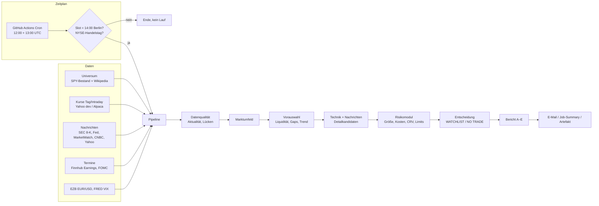

# Phase 1 – Anforderungen, Architektur, Datenquellen, Kosten

Stand: 25.10.2026 · Status: Phase 1 abgeschlossen, Prototyp (Phasen 3–5 und 7 in Grundform) lauffähig

## 1. Leitplanken (nicht verhandelbar)

1. Kapitalerhalt vor Rendite. **KEIN TRADE** ist ein vollwertiges Ergebnis.
2. Reiner Analyse- und Berichtsbetrieb. Kein Brokerzugriff, keine Orders, kein Hebel.
3. Keine erfundenen Daten: Fehlende, veraltete oder widersprüchliche Daten werden im Bericht genannt.
   Ist die Datenlage unzureichend, bricht der Lauf mit einer Meldung ab, statt eine Analyse vorzutäuschen.
4. Solange keine Validierung vorliegt (`validierung.strategien_validiert: false`), gibt das System höchstens
   **WATCHLIST** aus. LONG/SHORT erst nach dokumentiertem Backtest und Paper-Trading.
5. Das Tagesziel von 200–300 € beeinflusst weder Positionsgröße noch Anzahl der Trades.

## 2. Anforderungen

| Bereich | Anforderung | Umsetzung im Prototyp |
|---|---|---|
| Zeitplan | Bericht an jedem US-Handelstag um 14:00 Uhr Berlin | GitHub Actions, zwei UTC-Slots + Prüfung im Code |
| Kalender | echter NYSE-Kalender, Halbtage, Sonderschließungen | Regelwerk + Konfigliste, gegen nyse.com getestet |
| Zeitzonen | DST-Abweichungen DE/US berücksichtigen | Hinweis im Bericht, Uhrzeiten aus `zoneinfo` |
| Universum | aktueller S&P-500-Bestand, keine statische Liste | SPY-Bestandsliste (täglich) + Wikipedia-Abgleich |
| Markt | S&P 500, Nasdaq-100, VIX, Sektoren, Futures | `^GSPC`, `^NDX`, VIX (FRED/Yahoo), 11 Sektor-ETFs, ES/NQ |
| Nachrichten | Quelle, URL, ET- und Berlin-Zeit, Art, Status, Tendenz, Vertrauen, Bestätigung | RSS/Atom-Pipeline mit Deduplizierung |
| Technik | SMA 20/50/100/200, EMA 9/21, RSI, MACD, ATR, VWAP, RVOL, RS, S/R, Gaps, Kerzen | `spx/indikatoren.py` |
| Zeitebenen | Tag, 4h, 1h, 15/5 Min. | Tag + 1h/4h (Trendbestätigung) + 5-Min.-Vorbörse |
| Risiko | Positionsgröße aus Geldrisiko, Kosten, Limits, Korrelation | `spx/risiko.py` |
| Bericht | Abschnitte A–E, 16 Felder je Setup, Quellen | `spx/bericht.py` (Markdown) |
| Sicherheit | Secrets, keine Veröffentlichung privater Zahlen | GitHub Secrets; Berichtsinhalt nur in privaten Repos/E-Mail |

## 3. Architektur

Module (`trading/spx/`):

| Modul | Aufgabe |
|---|---|
| `kalender.py` | NYSE-Feiertage, Halbtage, Sitzungszeiten ET/Berlin, DST-Hinweis, Cron-Slot-Prüfung, Marktphase |
| `daten/kurse.py` | Kursquellen hinter einer gemeinsamen Schnittstelle (Yahoo, Alpaca) |
| `daten/universum.py` | S&P-500-Bestand mit Stichtag, Abgleich, Zwischenspeicher |
| `daten/markt.py` | EZB-Referenzkurs, FRED-Reihen |
| `nachrichten.py` | Abruf, Zeitstempel, Tickerzuordnung (SEC-CIK, Kürzel, Name), Einordnung, Deduplizierung |
| `termine.py` | Quartalszahlen (Finnhub, optional), FOMC-Termine |
| `indikatoren.py` | Indikatoren ohne Look-ahead |
| `umfeld.py` | Marktbreite, Indizes, Futures, VIX → positiv / negativ / uneinheitlich |
| `setups.py` | Swing-Regeln (Pullback, Ausbruch, optional Short), Day-Szenario (Gap + ORB) |
| `risiko.py` | Kostenmodell, Positionsgröße, Netto-CRV, Tages-/Gesamtlimit, Korrelation |
| `ziel.py` | Realitätsprüfung des Tagesziels |
| `bericht.py` | Markdown-Bericht |
| `pipeline.py` | Ablaufsteuerung |
| `versand.py` | E-Mail per SMTP |

## 4. Täglicher Ablauf und Zeitzonen

| Schritt | Normal (6 h Versatz) | Umstellungswochen (5 h) |
|---|---|---|
| US-Vorbörse beginnt (04:00 ET) | 10:00 Berlin | 09:00 Berlin |
| **Bericht** | **14:00 Berlin = 08:00 ET** | **14:00 Berlin = 09:00 ET** |
| US-Eröffnung (09:30 ET) | 15:30 Berlin | **14:30 Berlin** |
| Verfall Day-Setups (11:00 ET) | 17:00 Berlin | 16:00 Berlin |
| US-Schluss (16:00 ET; Halbtag 13:00) | 22:00 Berlin | 21:00 Berlin |

Umstellungswochen (Handelstage mit 5 h Versatz): 09.–27.03.2026, **26.–30.10.2026**, 15.–25.03.2027,
01.–05.11.2027. In diesen Wochen liegt der Bericht nur 30 Minuten vor der Eröffnung.

Zur Uhrzeit: Abschnitt 12 deiner Vorgabe nennt einmal 14:00 und einmal 16:00 Uhr. Umgesetzt ist **14:00 Uhr**
(vorbörslich, klar getrennt von nach Eröffnung zu bestätigenden Signalen). Ein zweiter Lauf um ca. 16:00 Uhr
(nach der 15-Minuten-Opening-Range) ist als Erweiterung in Phase 7 vorgesehen.

GitHub-Actions-Zeitpläne können sich bei hoher Last um 5–30 Minuten verzögern, laufen nur auf dem
Standardbranch und werden in öffentlichen Repositories nach 60 Tagen ohne Aktivität pausiert.

## 5. Datenquellen (Phase 2 – Bewertung)

| Zweck | Quelle | Status | Kosten | Grenzen / Bedingungen |
|---|---|---|---|---|
| Kurse (Entwicklung) | Yahoo-Finance-Chart-Endpunkt | aktiv | 0 € | inoffiziell, keine Zusage, nur privater Gebrauch; nicht für Dauerbetrieb |
| Kurse (Betrieb) | [Alpaca Market Data](https://docs.alpaca.markets/docs/about-market-data-api) Free | vorbereitet | 0 $ | Echtzeit nur IEX-Feed (Teilvolumen), SIP historisch ≥ 15 Min. verzögert, 200 Anfragen/Min. |
| Kurse Echtzeit (Daytrading) | Alpaca Algo Trader Plus | optional | 99 $/Monat | alle US-Börsen (SIP), 10.000 Anfragen/Min. |
| Alternative | Massive (ehem. Polygon.io) | geprüft | laut Drittquellen ab ca. 29 $/Monat (verzögert), Echtzeit ca. 199 $/Monat – vor Abschluss auf der Anbieterseite prüfen | |
| Universum | SSGA-Bestandsliste SPY (xlsx) | aktiv | 0 € | Stichtag = Vortag; offizielle S&P-DJI-Daten sind lizenzpflichtig |
| Sektoren | Wikipedia „List of S&P 500 companies“ | aktiv | 0 € | Sekundärquelle (CC BY-SA), nur Abgleich |
| Quartalszahlen-Termine, Firmennews | Finnhub Free | vorbereitet (Schlüssel fehlt) | 0 $ | ca. 60 Anfragen/Min., private Nutzung; bezahlt laut Drittquellen ab ca. 50 $/Monat |
| Pflichtmitteilungen | SEC EDGAR (8-K-Feed, Tickertabelle) | aktiv | 0 € | User-Agent mit Name + E-Mail Pflicht, max. 10 Anfragen/s |
| Fundamentaldaten | SEC EDGAR XBRL (companyfacts) | Phase 4 | 0 € | wie oben |
| Notenbank | Fed-RSS, FOMC-Kalender | aktiv | 0 € | – |
| Makro-Kalender | FRED-API (Release-Termine), BLS/BEA | Phase 2 offen | 0 € | API-Schlüssel (kostenlos) |
| Medien | MarketWatch-RSS, CNBC-RSS, Yahoo-Ticker-RSS | aktiv | 0 € | nur Schlagzeilen + Link |
| Reuters, Bloomberg, FT | – | nicht angebunden | lizenzpflichtig (vier- bis fünfstellig pro Jahr) | keine freien APIs; Bezahlschranken werden nicht umgangen |
| Finviz, TradingView, Investing.com | – | nicht angebunden | – | keine offizielle Daten-API; Scraping verstößt gegen Nutzungsbedingungen. Nur manuelle Nutzung |
| Wechselkurs | EZB-Referenzkurs | aktiv | 0 € | einmal täglich ca. 16:00 MEZ; um 14:00 gilt der Vortageskurs |
| VIX | FRED VIXCLS / Yahoo `^VIX` | aktiv | 0 € | FRED nur Schlusskurs Vortag |

## 6. Cloud-Optionen und laufende Kosten

| Option | Inhalt | Kosten/Monat | Bewertung |
|---|---|---|---|
| **A – GitHub Actions (empfohlen ab sofort)** | Zeitplan, Tests, Bericht, E-Mail; privates Repo | 0 € (≈ 70–100 der 2.000 Freiminuten) | geringster Aufwand; keine Datenbank, Cron kann sich verzögern |
| B – Google Cloud | Cloud Scheduler (Zeitzone Europe/Berlin direkt), Cloud Run Job, Secret Manager, Postgres (Cloud SQL oder Neon/Supabase), Dashboard | ca. 0–15 € (je nach Datenbank) | ab Paper-Trading (Phase 8/9): Datenbank, Dashboard, Monitoring |
| C – eigener VPS (z. B. Hetzner) | cron + Postgres + Streamlit | ca. 5–10 € | günstig, aber selbst zu warten und abzusichern |

Gesamtkosten-Schätzung: **Phase 1–6: 0 €/Monat.** Paper-Trading mit Datenbank: ca. 0–15 €/Monat.
Echtzeit-Daytrading mit vollem US-Volumen (SIP): zusätzlich ca. 99 $/Monat (Alpaca) oder vergleichbar.

## 7. Sicherheit und Datenschutz

- API-Schlüssel und Kapital nur als GitHub-Secrets bzw. in `config/lokal.yaml` (ausgeschlossen per `.gitignore`).
- **Dieses Repository ist öffentlich (GitHub Pages).** Der Workflow schreibt den Berichtsinhalt deshalb nicht in
  Logs/Artefakte, sondern nur in privaten Repositories oder per E-Mail. Empfehlung: das System in ein eigenes,
  privates Repository verschieben.
- Keine Brokerzugangsdaten im System. Eine Brokeranbindung (Phase 10) erhält ein eigenes Modul, eigene Schlüssel
  mit minimalen Rechten, Paper-Konto zuerst, Idempotenz-Schlüssel gegen doppelte Orders und manuelle Freigabe.
- Datenfehler werden pro Quelle protokolliert und im Bericht ausgewiesen.

## 8. Phasenplan mit Akzeptanzkriterien

| Phase | Arbeitsergebnis | Tests | Akzeptanzkriterium | Status |
|---|---|---|---|---|
| 1 Anforderungen/Architektur | dieses Dokument | – | offene Entscheidungen benannt | ✅ |
| 2 Datenquellen | Quellenmatrix, Schlüssel für Alpaca/Finnhub/FRED, Nutzungsbedingungen geprüft | Verbindungstests je Quelle | jede Quelle mit Kosten, Limit, Lizenz dokumentiert; Fallback definiert | 🟡 Matrix fertig, Schlüssel fehlen |
| 3 Daten-Pipeline | Kurse, Universum, News, Termine; Zwischenspeicher | Parser-Tests, Aktualitätsprüfung | Lauf bricht bei < 80 % aktuellen Titeln ab; jede Meldung mit URL und ET/Berlin-Zeit | 🟡 Prototyp |
| 4 Analyse | Indikatoren, MTF, Fundamentaldaten (EDGAR), Gewichtungsmodell | Referenzwerte (z. B. Wilder-RSI) | Indikatoren reproduzierbar; Fundamentaldaten mit Stichtag | 🟡 Technik fertig, Fundamentaldaten offen |
| 5 Risiko | Positionsgröße, Kosten, Limits, Korrelation, Gap-Risiko | Handrechnungen, Grenzfälle | Verlust am Stop inkl. Kosten ≤ Budget; Limit sperrt neue Ideen | ✅ Grundform |
| 6 Backtesting | Ereignisgesteuerter Backtester, Kosten/Slippage, Walk-Forward, Benchmark (SPY Buy & Hold), historische Indexmitglieder | Look-ahead-Tests, Survivorship-Check | Out-of-Sample-Kennzahlen (Netto, Max-Drawdown, Profit Factor, Trefferquote) je Strategie dokumentiert, auch negative | ⬜ |
| 7 Tagesbericht | 14:00-Bericht, optional 16:00-Bestätigung | Ende-zu-Ende-Test offline | Abschnitte A–E vollständig; bei Feiertag/Datenmangel Meldung statt Analyse | ✅ Prototyp |
| 8 Deployment/Monitoring | Zeitplan, Secrets, Alarm bei Fehlschlag, Signal-Datenbank | Probelauf, Fehlerinjektion | 20 Handelstage ohne unbemerkten Ausfall | 🟡 Workflow fertig |
| 9 Paper-Trading | Protokoll aller Signale und Ergebnisse, Auswertung | Abgleich Signal ↔ Ergebnis | mind. 3 Monate bzw. ≥ 100 Signale; Kennzahlen innerhalb der Backtest-Bandbreite | ⬜ |
| 10 Broker (optional) | separates Modul, Paper-Konto, Freigabe-Workflow | Integrationstests gegen Paper-API | nur mit deiner ausdrücklichen Freigabe | ⬜ |

## 9. Regeln des Prototyps (nicht validiert)

**Swing – Pullback im Aufwärtstrend:** Kurs > SMA50 > SMA200, SMA50 steigend; 3-Tage-Tief innerhalb 0,5 ATR an
EMA21/SMA20; RSI 35–60. Einstieg: Kauf-Stop 0,05 ATR über Vortageshoch. Stop: 3-Tage-Tief − 0,25 ATR.
Ziel 1: nächster Widerstand (Umkehrpunkt), sonst 2,5 R (Schätzung). Ziel 2: 3 R.

**Swing – Ausbruch über 55-Tage-Hoch:** Aufwärtstrend, Kurs ≤ 3 % unter dem 55-Tage-Hoch. Einstieg: Hoch + 0,1 ATR,
Bestätigung durch Volumen ≥ 1,5 × Durchschnitt. Stop: Einstieg − 1,5 ATR.

**Day – Gap + Opening-Range-Breakout:** Gap ≥ max(1,5 %, 0,5 ATR), Katalysator nach Vortagesschluss,
Vorbörsenvolumen, Gap ≤ 2 ATR. Vorläufige Niveaus (Vorbörsenhoch, geschätzte Opening Range 0,35 ATR);
**gültig erst nach den ersten 15 Minuten**, Verfall 11:00 ET, Schließen bis 15:45 ET.

Alle Setups durchlaufen das Risikomodul (Mindest-CRV 2 nach Kosten, Stop 0,3–3 ATR). Qualität = Anteil erfüllter
Checklisten-Kriterien, ausdrücklich keine Wahrscheinlichkeit. Die Gewichtung wird in Phase 6 empirisch geprüft.

## 10. Bekannte Grenzen des Prototyps

- Kursquelle Yahoo ist inoffiziell und liefert vorbörslich meist kein Volumen (Kriterium dann „ungeprüft“).
- Tickerzuordnung von Medienmeldungen ist heuristisch; Tendenz/Art sind Schlagwortregeln.
- Ohne Finnhub-Schlüssel sind Quartalszahlen-Termine ungeprüft – Swing-Ideen tragen dann diesen Warnhinweis.
- Kein Makro-Kalender außer FOMC; keine Fundamentaldaten; keine Datenbank; keine offenen Positionen (Werte per
  Umgebungsvariable `SPX_TAGESERGEBNIS_EUR` / `SPX_OFFENES_RISIKO_EUR`).
- Survivorship-Bias: Für Backtests werden historische Indexmitglieder benötigt (Phase 6).
